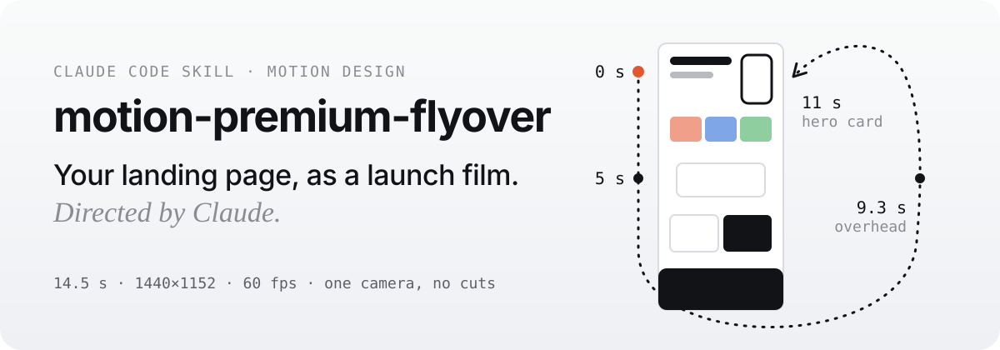
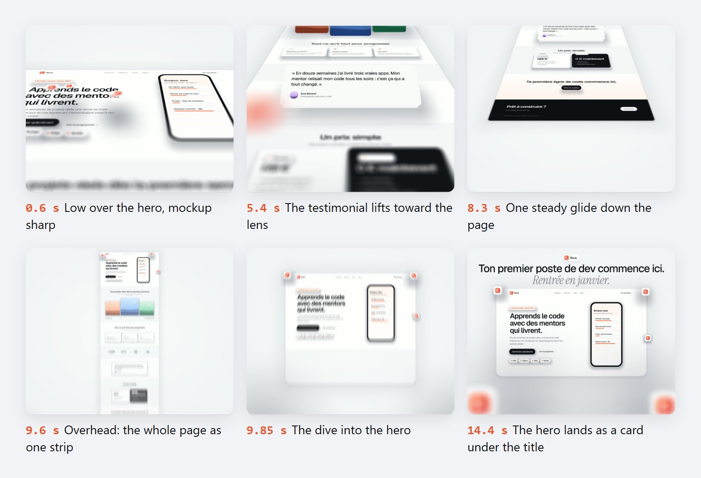

<p align="center">
  
</p>

Give Claude the link to your landing page. It films the real page lying on a bright studio floor: one camera glides down it, pieces lift toward the lens with a razor-thin depth of field, the camera rises to show the whole page, then dives into the hero, which lands as a card under your title. You approve still frames before anything is rendered.

<p align="center">
  
</p>

## Install

In Claude Code, run:

```text
/plugin marketplace add stvekoulo/motion-premium-flyover
/plugin install motion-premium-flyover@stvekoulo
```

Or ask Claude to do it:

```text
Install the motion-premium-flyover plugin from the GitHub repository stvekoulo/motion-premium-flyover.
```

Or copy the skill by hand:

```bash
git clone https://github.com/stvekoulo/motion-premium-flyover
cp -r motion-premium-flyover/skills/motion-premium-flyover ~/.claude/skills/
```

## Make your first film

Ask Claude in plain words. The skill starts on its own:

```text
Make a premium launch film of my landing page https://example.com.
Brand: Kora, logo: ./logo.svg.
Closing line: "Your first dev job starts here." / "Next intake in January."
```

Claude then works through these steps, and you never edit code or config:

1. **Capture.** Opens your page at 1440 px, freezes its animations and marks the pieces that will lift (mockup, cards, chips, testimonial).
2. **Stills.** Shows you seven key frames and waits for your go. You describe changes ("the chip is too big at 2.5 s"); Claude applies them.
3. **Motion check.** Measures the camera with optical flow: no dip, no reverse, no zoom-in during the glide.
4. **Render.** 60 fps with motion blur, then sound: your track's hit lands on the dive, whooshes are synthesized, loudness set to −14 LUFS.

## What the film is

| | |
|---|---|
| Length and format | 14.5 s, 1440 × 1152, 60 fps, MP4 |
| Camera | one continuous move, no cuts, no crossfades |
| Depth | sharp in the centre, the lens melts what is near it |
| Ending | your hero as a card under a two-line title (statement, then an italic tail) |
| Sound | optional: your track, the built-in whooshes, or ElevenLabs if connected |

## Rebuild a reference video

Send Claude a video you like and ask for "the same, with my texts". It analyses the reference frame by frame, shows you a scene table, rebuilds every shot and compares both versions side by side at the same instants. This mode needs the separate **motion-designer** skill as its render engine.

## Requirements

- Claude Code (the film is rendered by scripts on your machine; claude.ai chat can only preview)
- Node 18+, ffmpeg, Google Chrome or Playwright Chromium
- A real GPU. On an integrated GPU the final render takes 30 to 45 minutes.

## En français

Ce skill pour Claude Code transforme votre landing page en film de lancement de 14,5 s : une seule caméra survole la vraie page, les éléments se soulèvent vers l'objectif, puis la caméra plonge dans le hero qui se pose sous votre titre. Vous validez des images clés avant le rendu, et vous n'écrivez aucun code.

Pour l'installer, tapez dans Claude Code :

```text
/plugin marketplace add stvekoulo/motion-premium-flyover
/plugin install motion-premium-flyover@stvekoulo
```

Ou demandez simplement à Claude : « Installe le plugin motion-premium-flyover depuis le dépôt GitHub stvekoulo/motion-premium-flyover. »

## License

[MIT](./LICENSE) © Steven KOULO
